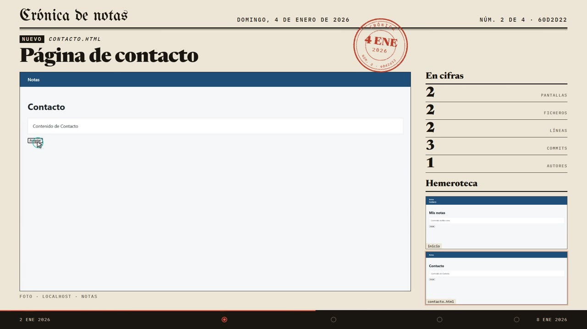
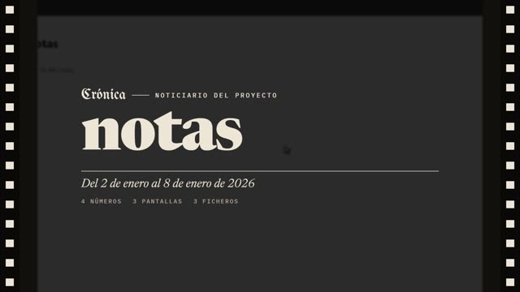
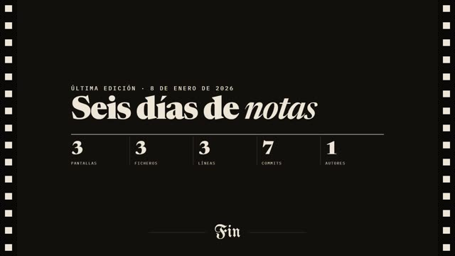

<p></p>

# cronica

Le das la carpeta de un proyecto y te devuelve el vídeo de cómo fue cambiando su interfaz a lo largo de la
historia git: un hito por escena, con lo que se veía en ese momento, el mosaico de componentes o pantallas
creciendo, las cifras subiendo, un rótulo por hito y música.

```
cronica C:\proyectos\mi-app
```

…o arrastra la carpeta sobre `cronica.exe`. El vídeo se guarda al lado del proyecto, en `mi-app-evolucion.mp4`.

## Qué hace

1. **Lee la rama activa** por su primer padre. Si se trabajó con PR (merges), cada PR es un hito. Si no, se
   eligen commits según cuánto cambian, no según la fecha. Por defecto hay como mucho 30 hitos (`-n`).
2. **Detecta qué fotografiar** en el último commit. Ese tipo se mantiene en todo el vídeo:
   - **Storybook**: un script `storybook:build` o `build-storybook`, o una carpeta `.storybook`. Se fotografía
     cada componente en claro y en oscuro, más el Storybook entero en el componente que entra en ese hito.
   - **App web**: Vite, Angular, React, Vue, Next, Astro, Svelte… Se construye con `build` y, si eso no deja
     un `index.html`, se arranca `dev`/`start`. Se fotografía la portada y las pantallas que enlaza.
   - **HTML estático**: un `index.html` en la raíz, `docs/`, `public/`…
   - Si no hay interfaz, cronica lo dice y no hace nada. La v1 solo cubre proyectos con interfaz.
3. **Construye cada hito en un clon propio** (`git clone --shared` en la caché). Tu carpeta no se toca:
   ni checkout, ni `node_modules`, ni ficheros nuevos. Las dependencias solo se reinstalan cuando cambia
   el lock.
4. **Escribe los rótulos** a partir del título de cada PR o commit. Entiende los merges de GitHub, GitLab,
   Bitbucket y Azure DevOps, quita claves de Jira y prefijos `feat:`. Con `--ia`, los escribe un modelo
   **local**.
5. **Graba** el reproductor fotograma a fotograma (1080p, 30 fps) y le pone una música generada, sin
   derechos (`--musica` para elegir el estilo o poner la tuya).

Todo queda en caché. Si se corta o falla, al relanzar sigue donde lo dejó. Para cambiar un texto, edita
`rotulos.json` (cronica dice dónde está al terminar) y relanza: solo se vuelve a grabar el vídeo.

## Cómo se ve



El vídeo es un diario del proyecto. Empieza como un noticiario, en sala oscura y con la película a los lados.
Cada hito es una primera plana: la cabecera con la fecha y «Núm. N de M · commit», un sello rojo que cae al
entrar, el titular, la app en uso como foto de portada con su pie, «En cifras» y la hemeroteca con todo lo que
ya salió. Abajo va la tira con las fechas. Se cierra con la última edición y «Fin».

<p> </p>

Con `--estetica clasica` sale la versión anterior: fondo oscuro, sin cabecera ni sello.

Las letras van con el programa, así que se graba igual sin red: Newsreader, UnifrakturMaguntia e
IBM Plex Mono, las tres con licencia SIL OFL (`cronica/reproductor/fonts/`).

## Opciones

| | |
|---|---|
| `-o, --salida X.mp4` | dónde dejar el vídeo |
| `-n, --max-hitos 30` | escenas como mucho |
| `--rama develop` | otra rama (también `origin/develop`) |
| `--modo storybook\|web\|estatico` | forzar lo que se fotografía |
| `--ia [modelo]` | rótulos con Ollama (`127.0.0.1:11434`) o con un servidor compatible con OpenAI (`CRONICA_LLM=http://127.0.0.1:1234/v1`). Nada sale de la máquina. |
| `--musica consola\|noticiario\|ambiente` | la música generada: `consola` (por defecto), una canción alegre de salón con swing, como los menús de consola; `noticiario`, una marcha de noticiario de cine con metales y caja, a juego con el diario; `ambiente`, un fondo sin melodía que cambia de acorde con cada escena |
| `--musica pista.mp3` / `--sin-musica` | música propia o ninguna |
| `--estetica diario\|clasica` | cómo se ve el vídeo: el diario (por defecto) o la clásica, oscura y sobria. También vale la ruta de un `.html` propio que lea `datos.json` y exponga `seek()` como los de `cronica/reproductor/esteticas/` |
| `--segundos 6` | segundos como mucho de app en uso por hito |
| `--ocultar lineas` | una cifra que no sale en el vídeo (se puede repetir) |
| `--nombre carpeta=nombre` | el nombre con el que sale un repositorio (si se ha renombrado) |
| `--tambien otra-carpeta` | un repositorio que no sale en pantalla pero cuenta en las cifras |
| `--paseo [60]` | al final, un paseo por todos los componentes cambiando los temas de Storybook |
| `--demo demo.json` | al final, una demo guiada de Storybook (ver abajo) |
| `--previa` | no graba el vídeo: deja un fotograma por escena para revisar |
| `--reintentar` | vuelve a construir los hitos que fallaron |
| `--desde-cero` | borra la caché de este proyecto |

La caché está en `%LOCALAPPDATA%\cronica` (Windows) o en `~/.cache/cronica` (Linux), con una carpeta por
proyecto. Dentro, `logs/` guarda la salida de cada instalación y cada build.

### La mesa de redacción: `rotulos.json`

Además de un rótulo por escena (`rotulos`), admite:

- `titulo` y `cierre`: la portada y la frase de la última edición; `pie`, una línea pequeña debajo del cierre.
- `notas`: una línea por escena, como subtítulo (mismas claves que `rotulos`).
- `actos`: `[{"desde": "<clave de escena>", "titulo": "…", "frase": "…"}]`. Antes de esa escena entra un
  cartel con «Acto I», «Acto II»… Sirve para contar el vídeo por partes.

### La demo guiada: `--demo demo.json`

```json
{
 "sitio": "~/mi-sb/storybook-static",
 "pasos": [
  {"story": "inicio--guia", "segundos": 5, "rotulo": "La guía", "acciones": [{"leer": true}]},
  {"story": "button--primary", "segundos": 6, "acciones": [{"global": "Dark"}, {"clic": "button"}, {"usar": 1}]}
 ]
}
```

Cada paso es una escena grabada en vivo. Las acciones posibles son:
- `global`: cambia una opción de la barra de Storybook;
- `clic`: pulsa un selector de la story, o de Storybook con `"en": "barra"`;
- `usar`: toca los controles de la story;
- `leer`: recorre el texto con el cursor;
- `rueda`: desplaza la página.

`sitio` es opcional; si no se da, la demo se graba sobre el último build. En el diario estas escenas salen
como «Edición en directo» y no cuentan como números.

## Requisitos

- git, Node (con el gestor del proyecto: npm, pnpm o yarn; pnpm y yarn también valen vía corepack) y ffmpeg.
- Python 3.10+ con `pip install .`, o el `.exe` de Windows (`empaquetar.ps1`). El Chromium de Playwright se
  descarga solo la primera vez. Si `ffmpeg.exe` está junto a `cronica.exe`, se usa ese.

## Límites conocidos

- Los commits antiguos se construyen con el Node que tengas instalado. Si un hito viejo necesitaba otra
  versión, falla, se salta y queda en el log. Para builds de webpack 4 se reintenta solo con
  `--openssl-legacy-provider`.
- Un proyecto que solo construye en Linux falla en Windows: lánzalo desde WSL.
- Una app que necesita un backend para pintar algo sale vacía y se salta.
