<div align="center">

<picture>
  <source media="(prefers-color-scheme: dark)" srcset="assets/logo-dark.png">
  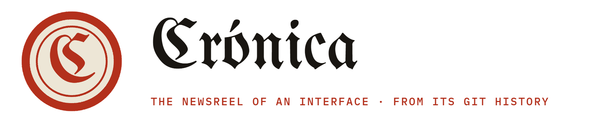
</picture>

<p>
<em>A <strong>crónica</strong> is the newspaper's account of what happened, told in the order it happened.<br>
This one is written by your git history, and the photographs are taken by a browser.</em>
</p>

<p><strong>Give it the folder of a project with an interface.<br>It hands back the film of how that interface grew: one front page per pull request.</strong></p>

<p>
  
  
  
  
  
</p>

<a href="#the-example"><strong>The example</strong></a> ·
<a href="#your-first-film"><strong>First film</strong></a> ·
<a href="#how-it-looks"><strong>How it looks</strong></a> ·
<a href="#how-an-issue-is-made"><strong>How it works</strong></a> ·
<a href="#what-makes-the-news"><strong>What makes the news</strong></a> ·
<a href="#music"><strong>Music</strong></a> ·
<a href="#the-newsroom-settings"><strong>Settings</strong></a> ·
<a href="#languages"><strong>Languages</strong></a> ·
<a href="#options"><strong>Options</strong></a> ·
<a href="#the-news-desk-rotulosjson"><strong>News desk</strong></a> ·
<a href="#a-guided-demo-at-the-end"><strong>Guided demo</strong></a> ·
<a href="#architecture"><strong>Architecture</strong></a> ·
<a href="#install"><strong>Install</strong></a> ·
<a href="#verification"><strong>Verification</strong></a> ·
<a href="#limits"><strong>Limits</strong></a>

</div>

---

<p align="center">
  <a href="assets/video/garden-newspaper.mp4">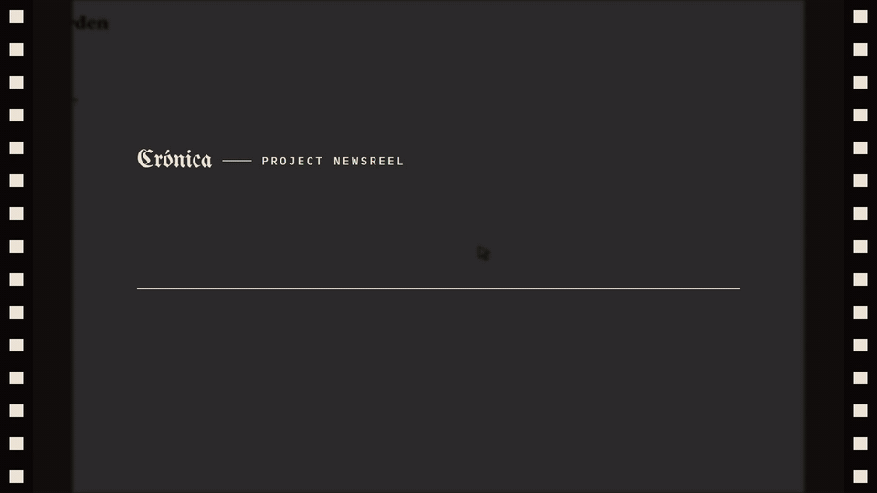</a>
</p>

<p align="center"><sub>Preview without sound.
<a href="assets/video/garden-newspaper.mp4"><b>The whole film with music</b></a> (0:41) ·
<a href="assets/video/garden-classic.mp4"><b>The same history, classic look</b></a> (0:41) ·
<a href="assets/video/huerto-diario.mp4"><b>En español</b></a> (0:41).
Nobody edited any of them: <code>cronica garden</code> made them from the folder.</sub></p>

## What it is

Every interface has a history, and it is already written down: commit by commit, pull request by pull request. What
nobody keeps is the *picture*. The screen from three months ago is gone, so is the one before the redesign, and when
somebody asks «how did we get here?» the answer is a changelog nobody reads.

Crónica reads that history and photographs it. It walks the branch, builds every milestone in a clone of its own,
opens each one in a browser, uses it with a visible cursor, compares it with the one before, and prints the result as
a newspaper: one issue per pull request, the app in use as the front-page photo, the headline taken from the PR title,
the figures climbing in the margin and the archive of every screen already published. It opens like a cinema newsreel
and closes with the final edition.

```
cronica C:\projects\my-app
```

…or drag the folder onto `cronica.exe`. The film is saved next to the project as `my-app-evolution.mp4`.

| | |
|---|---|
| **What it photographs** | Storybook (every component, light and dark), web apps (Vite, Angular, React, Vue, Next, Astro, Svelte…) and plain HTML |
| **What it needs from you** | the folder. Nothing in it is checked out, installed or written |
| **What it never does** | send anything anywhere. The optional AI headlines use a model on your machine, or the server you choose |
| **What you can change** | every headline, without building again: [`rotulos.json`](#the-news-desk-rotulosjson) |
| **Which language, which model** | chosen in [its own window](#the-newsroom-settings), *the newsroom*: English or Spanish, and the AI model that writes the headlines |

---

<a id="the-example"></a>

## The example: *Garden*

The film above is [`examples/garden/`](examples/garden/construir.py): a small garden planner written as a static web
page, which grows over four months in nine pull requests by three people. Run the script and you have the same
repository, with the same dates, the same authors and the same commit hashes, so the film comes out the same every
time.

```
python examples/garden/construir.py garden
cronica garden
```

With `--lang es` the script builds the same history in Spanish (*Huerto*), and `cronica huerto --lang es` films it in
Spanish: that is the third film linked above.

| Issue | Pull request | What the film shows |
|:---:|---|---|
| 1 | *First page* | A bare list of eight plants, in the browser's default serif |
| 2 | #1 A header and the garden's colours | The green header arrives |
| 3 | #2 Plant cards with their drawing | A new screen: the cursor clicks *Plants* and the cards appear |
| 4 | #3 Sowing and harvest calendar | A new screen, the calendar |
| — | #4 Dark mode | **No page.** In light mode nothing changed, [so it is not news](#what-makes-the-news) |
| 5 | #5 Filters by kind and a plant search | The cursor presses *Fruit*, *Leaf*, *Root*: the grid filters itself |
| 6 | #6 The watering chart, week by week | A new screen; the cursor steps through the weeks |
| 7 | #7 A home page with the weather and today's tasks | The cursor ticks tasks off |
| 8 | #8 A new typeface and rounded cards | Four screens change at once: the redesign |
| 9 | #9 Settings for units and frost alerts | A new screen, then the final edition |

---

<a id="your-first-film"></a>

## Your first film, step by step

For anyone with a project folder and no wish to open a terminal. Windows, no administrator rights.

**1. Download.** From the [latest release](https://github.com/gitsual/cronica/releases/latest), take
`cronica-<version>-windows.zip` (about 126 MB: the program and its ffmpeg). The browser it photographs with,
Playwright's Chromium, is downloaded the first time it is needed.

**2. Unzip and drop.** Unzip anywhere. Drag the folder of your project onto `cronica.exe`. A console opens and tells
you, issue by issue, what it found:

<p align="center">
  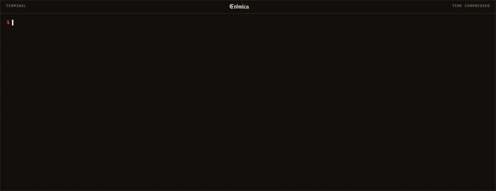
</p>

<p align="center"><sub>The real output of the run that made the film above; only the waiting has been cut.</sub></p>

**To change the language or the AI model,** double-click `cronica.exe` without dropping anything: it opens
[the newsroom](#the-newsroom-settings), its settings window.

**3. Watch.** The film is next to your project folder. If a headline reads badly, open the `rotulos.json` the console
names at the end, change it, and drop the folder again: only the film is printed again, everything else comes from
the cache.

> [!NOTE]
> The project has to build on your machine: cronica runs its own `npm`, `pnpm` or `yarn` in each clone, with the Node
> you have installed. A milestone that does not build is skipped and its log is kept; the film goes on without it.

<details>
<summary><b>La misma guía, en español</b></summary>

cronica habla español: elígelo una vez en **la redacción**, su ventana de ajustes (doble clic en `cronica.exe` sin carpeta, o `cronica --settings`), donde también se elige el modelo de IA que escribe los titulares. También vale `--lang es` o `CRONICA_LANG=es`. En español sale todo: la consola, el vídeo (*Núm.*, *En cifras*,
*Hemeroteca*, *Última edición*), las fechas y los titulares que escribe la IA. Las opciones también se pueden escribir
en español: `--musica`, `--estetica`, `--previa`, `--ocultar lineas`…

1. **Descarga.** De la [última versión](https://github.com/gitsual/cronica/releases/latest), baja
   `cronica-<versión>-windows.zip` (unos 126 MB, con ffmpeg dentro). El Chromium de Playwright se descarga solo la
   primera vez.
2. **Elige el idioma y arrastra.** Descomprime donde quieras, haz doble clic en `cronica.exe`, elige *Español* en la
   redacción y guarda. Luego arrastra la carpeta de tu proyecto sobre `cronica.exe`.
3. **Mira.** El vídeo queda al lado de la carpeta, como `<carpeta>-evolucion.mp4`. Para cambiar un titular, edita el
   `rotulos.json` que te indica al final y vuelve a lanzarlo: solo se vuelve a grabar el vídeo.

Tu carpeta no se toca: cada hito se construye en un clon propio dentro de la caché. Si se corta, al relanzar sigue
donde lo dejó. [Así se ve en español](assets/video/huerto-diario.mp4).
</details>

---

<a id="how-it-looks"></a>

## How it looks

The film is a newspaper about the project. It opens as a newsreel, in a dark room with the film's perforations at the
sides. Every milestone is a front page: the masthead with the date and «No. N of M · commit», a red stamp that falls
as the page enters, the headline, the app in use as the photograph with its caption, *By the numbers* (screens, files,
lines, commits, authors) and the *Archive* of every screen published so far, with the ones this issue touched marked.
Along the bottom runs the strip with the dates. It closes with the final edition and the totals.

<p align="center">
  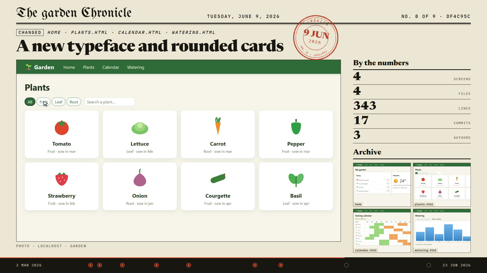
</p>

<p align="center">
  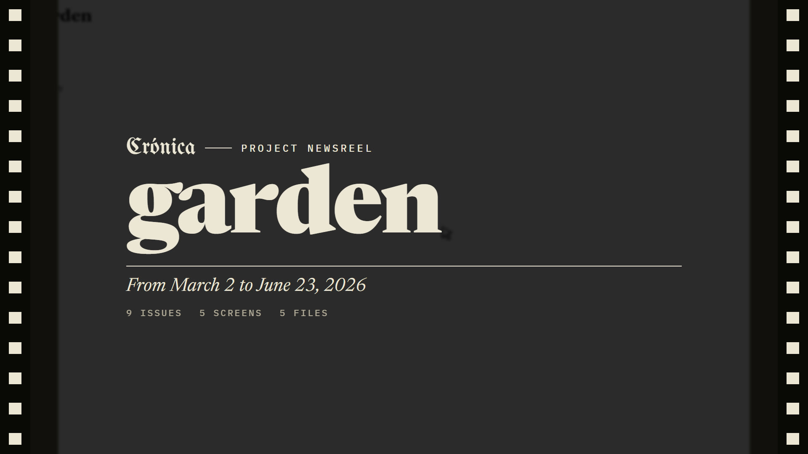
  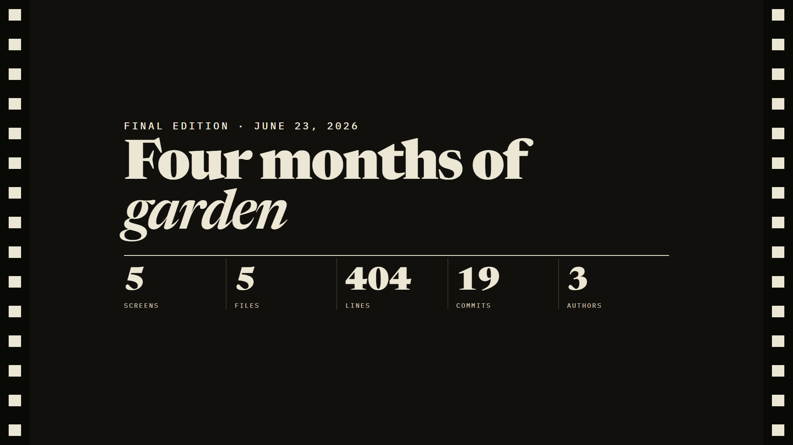
</p>

<p align="center"><sub>The opening, an issue, the final edition. Frames of the example film.</sub></p>

With `--look classic` the same history comes out in the earlier look: a dark, quiet stage with the app in a browser
frame, the figures on the right and the screens piling up beside it.

<p align="center">
  <a href="assets/video/garden-classic.mp4">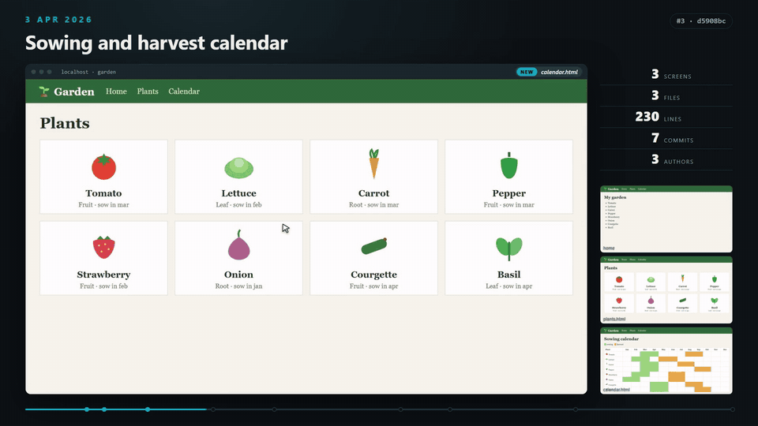</a>
</p>

A look is a single HTML page that reads `datos.json` and exposes `seek(t)`: `--look my-page.html` uses yours. Every
word and date it shows arrives already translated in `datos.json`, so your own look speaks every language cronica
does. The two that ship are in [`cronica/reproductor/esteticas/`](cronica/reproductor/esteticas). The typefaces
travel with the program, so it records the same without a network: Newsreader, UnifrakturMaguntia and IBM Plex
Mono, all three under the SIL Open Font License ([`cronica/reproductor/fonts/`](cronica/reproductor/fonts)).

### Proofs: `--preview`

Before printing the whole film, `--preview` leaves one frame per scene to look at:

<p align="center">
  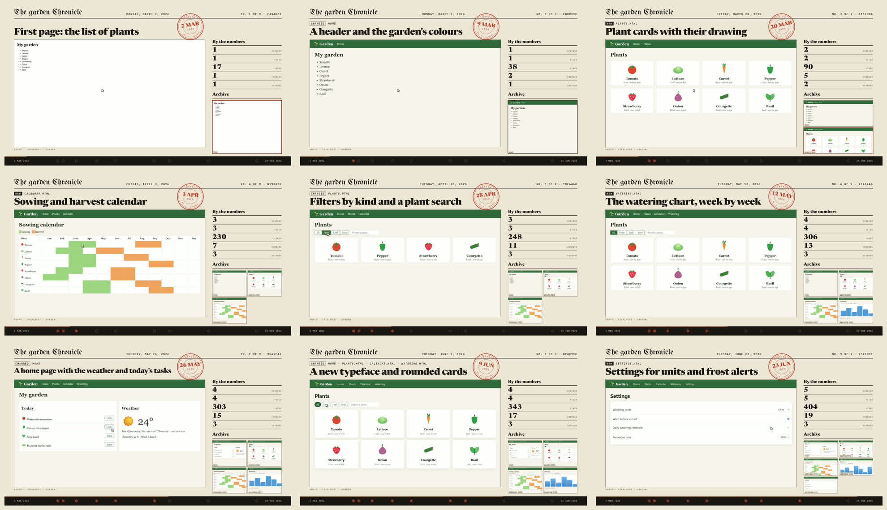
</p>

---

<a id="how-an-issue-is-made"></a>

## How an issue is made

<p align="center">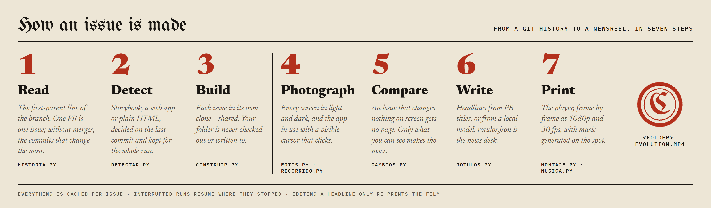</p>

1. **Read.** The active branch by its first parent. If the work went through pull requests, each merge is an issue; it
   understands the merge messages of GitHub, GitLab, Bitbucket and Azure DevOps. Without merges, commits are chosen by
   how much they change, not by date. At most 30 issues (`-n`).
2. **Detect.** What to photograph, decided on the last commit and kept for the whole film:
   - **Storybook**: a `storybook:build` or `build-storybook` script, or a `.storybook` folder. Every component in
     light and dark, and the whole Storybook on the component that arrives in that issue.
   - **Web app**: Vite, Angular, React, Vue, Next, Astro, Svelte… Built with `build`; if that leaves no `index.html`,
     started with `dev` or `start`. The home page and the screens it links to.
   - **Plain HTML**: an `index.html` at the root, in `docs/`, `public/`…
   - **No interface**: cronica says so and does nothing.
3. **Build.** Each issue in a `git clone --shared` inside the cache. Dependencies are installed again only when the
   lock file changes. Your folder is never checked out, never gets a `node_modules`, never gets a new file.
4. **Photograph.** Every screen, light and dark, at 1440×900. Then the app *in use*: a recorded clip with a visible
   cursor that travels on a curve, clicks with a red ring, types into fields and scrolls, on the screens that issue
   changed.
5. **Compare.** Each screen against the same screen in the issue before. [What did not change on screen is not
   news](#what-makes-the-news).
6. **Write.** A headline per issue from the PR title or commit subject, without Jira keys or `feat:` prefixes. With
   `--ai`, a model **on your machine** writes them, in the language of the run. Either way they land in
   [`rotulos.json`](#the-news-desk-rotulosjson).
7. **Print.** The player, frame by frame, at 1080p and 30 fps, mixed with [music](#music) generated for the length of
   the film and the moment each scene starts.

Everything is cached per issue. If a run stops or fails, the next one carries on where it was; `--retry` builds
again only the issues that failed.

---

<a id="what-makes-the-news"></a>

## What makes the news

A history is mostly commits nobody can see. Crónica keeps the ones that change the screen: a milestone gets a page if
at least one screen is new, or one existing screen differs from the issue before by more than a word's worth of
pixels. Storybook's own frame counts only when it really changes (a new theme), not for one more entry in its
sidebar.

<p align="center">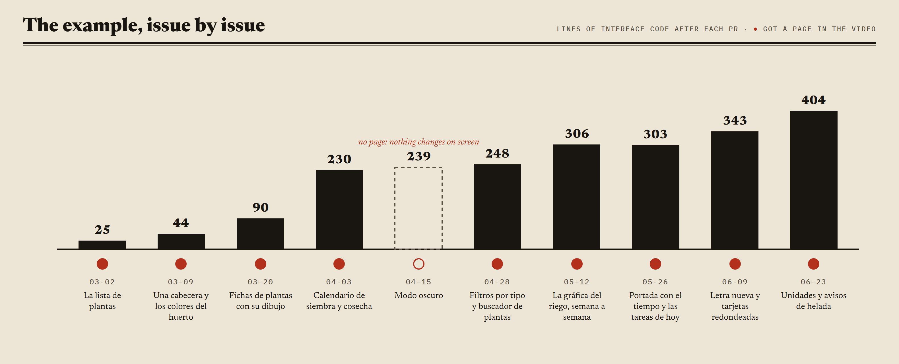</p>

In the example, *Dark mode* adds code but leaves the light screens exactly as they were, so it is counted in the
figures of the next issue and gets no page of its own. The same rule keeps a film of a long project watchable: in a
history of three hundred commits it is the thirty that changed the interface that make the film.

---

<a id="music"></a>

## Music

The music is written by the program for each film, so there are no rights to clear: its length is the film's, and
every scene change lands on it.

<p align="center">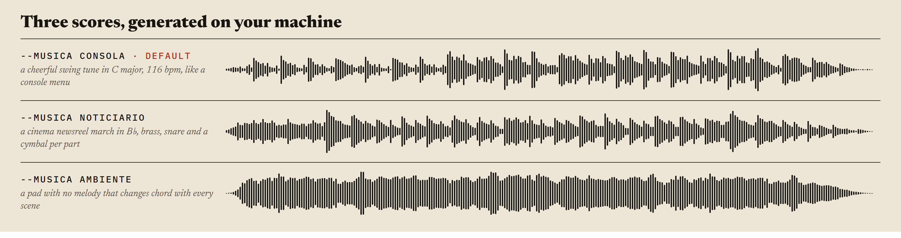</p>

| | Listen (40 s) |
|---|---|
| `--music console` (default): a cheerful parlour tune with swing, C major at 116 bpm, intro and A A B A, vibraphone melody, electric piano on the off-beat, bass, light percussion and a sparkle on every scene | [musica-consola.mp3](https://github.com/gitsual/cronica/releases/download/v0.3.0/musica-consola.mp3) |
| `--music newsreel`: a cinema newsreel march in B♭ at 128 bpm, fanfare, brass melody, tuba, snare rolls and a cymbal on every part; made for the newspaper look | [musica-noticiario.mp3](https://github.com/gitsual/cronica/releases/download/v0.3.0/musica-noticiario.mp3) |
| `--music ambient`: a pad with no melody that changes chord with every scene | [musica-ambiente.mp3](https://github.com/gitsual/cronica/releases/download/v0.3.0/musica-ambiente.mp3) |
| `--music track.mp3` · `--no-music` | your own track, or silence |

---

<a id="the-newsroom-settings"></a>

## The newsroom: settings

Everything that is a matter of taste is chosen in cronica's own window, *the newsroom*: the language, the model that
writes the headlines, the music, the look and the length. Double-click `cronica.exe` without a folder, or run
`cronica --settings`. What you save there is the default of every film; an option on the command line still wins
for that one run.

<p align="center">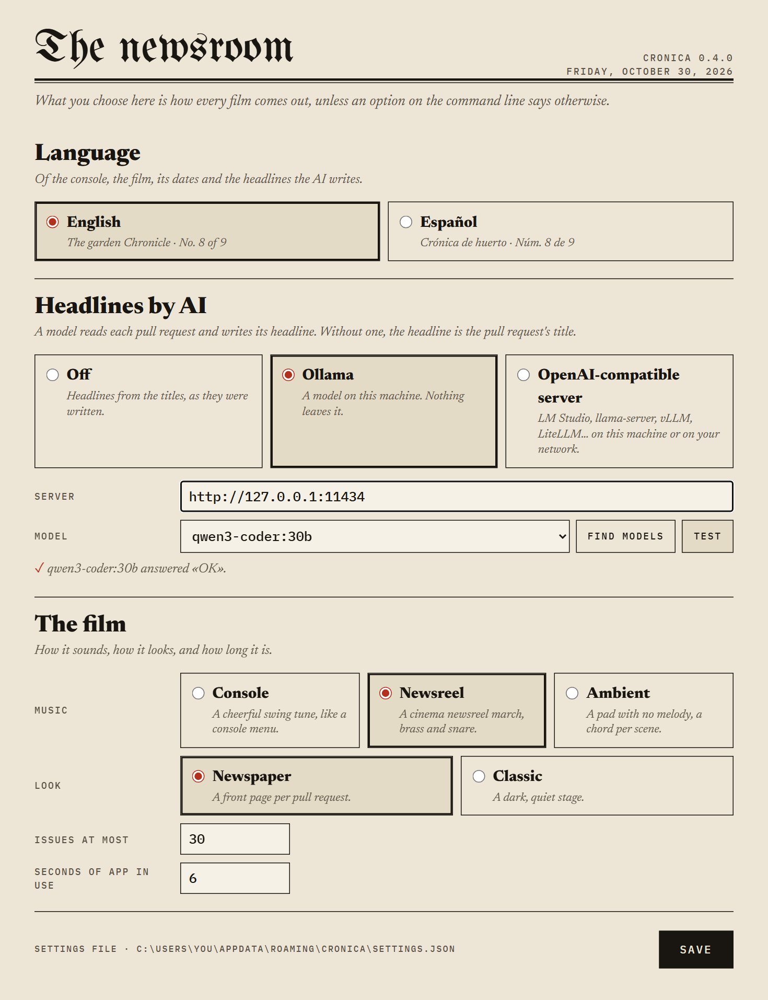</p>

| | |
|---|---|
| **Language** | English or Español, for the console, the film, its dates and the AI headlines |
| **Headlines by AI** | *Off* (headlines are the pull request titles), *Ollama* on this machine, or any *OpenAI-compatible server* (LM Studio, llama-server, vLLM, LiteLLM…) with its address and, if it needs one, an API key. *Find models* lists what the server offers; *Test* asks the chosen model a one-word question |
| **The film** | the music, the look, issues at most and seconds of app in use |

The settings live in `%APPDATA%\cronica\settings.json` (Windows) or `~/.config/cronica/settings.json` (Linux);
`CRONICA_CONFIG` points elsewhere. The window is served on `127.0.0.1` only, and the API key stays in that file.

---

<a id="languages"></a>

## Languages

English is the default; Spanish is one option away. The language covers everything cronica says: the console, the
film (masthead, *No.*, *By the numbers*, *Archive*, *Final edition*, the stamps, the dates and the span of the
closing line), the screen names it adds, and the headlines the local model writes with `--ai`.

| | English | Spanish |
|---|---|---|
| Choose it | default | in [the newsroom](#the-newsroom-settings), once; or `--lang es`, or `CRONICA_LANG=es` |
| The film | *The garden Chronicle* · *No. 8 of 9* · *By the numbers* · *Archive* · *Final edition* | *Crónica de huerto* · *Núm. 8 de 9* · *En cifras* · *Hemeroteca* · *Última edición* |
| Dates | Tuesday, June 9, 2026 · 9 JUN 2026 | Martes, 9 de junio de 2026 · 9 JUN 2026 |
| Output | `<folder>-evolution.mp4` | `<folder>-evolucion.mp4` |
| Options | `--music newsreel --look classic --hide lines` | the same, or `--musica noticiario --estetica clasica --ocultar lineas` |

Headlines that come from your pull request titles stay as they were written. The translations live in one table,
[`cronica/i18n.py`](cronica/i18n.py): a new language is a new column there.

---

<a id="options"></a>

## Options

| | |
|---|---|
| `--settings` | opens [the newsroom](#the-newsroom-settings), the settings window (also: double-click `cronica.exe`) |
| `--lang en\|es` | the [language](#languages) of the console and the film |
| `-o, --output X.mp4` | where the film goes |
| `-n, --max-milestones 30` | issues at most |
| `--branch develop` | another branch (also `origin/develop`) |
| `--mode storybook\|web\|static` | force what is photographed |
| `--ai [model]` | headlines written by the model chosen in the settings; without one, Ollama on `127.0.0.1:11434` (`CRONICA_LLM=http://…/v1` points it at an OpenAI-compatible server) |
| `--music console\|newsreel\|ambient\|track.mp3` · `--no-music` | [the music](#music) |
| `--look newspaper\|classic\|page.html` | [the look](#how-it-looks): the newspaper (default), the classic one, or your own player |
| `--seconds 6` | seconds of app in use per issue, at most |
| `--hide lines` | a figure that does not appear in the film (`components`, `screens`, `stories`, `files`, `lines`, `commits`, `authors`; repeatable) |
| `--name folder=name` | the name a repository appears under (if it was renamed) |
| `--also other-folder` | a repository that does not appear on screen but counts in the figures |
| `--walk [60]` | at the end, a walk through every component, switching Storybook's themes |
| `--demo demo.json` | at the end, [a guided demo](#a-guided-demo-at-the-end) of Storybook |
| `--preview` | no film: one frame per scene, [to review](#proofs---preview) |
| `--rerecord` | record the clips again from the saved sites, without building |
| `--retry` | build again the issues that failed |
| `--from-scratch` | delete this project's cache first |

Every option also answers to its Spanish name (`--salida`, `--rama`, `--musica`, `--previa`…), so older scripts keep
working. The cache lives in `%LOCALAPPDATA%\cronica` (Windows) or `~/.cache/cronica` (Linux), one folder per project
(`CRONICA_CACHE` moves it). Inside, `logs/` keeps the output of every install and build.

### The news desk: `rotulos.json`

One headline per scene, keyed by commit, written in the language of the run. In English:

```json
{
 "title": "garden",
 "closing": "From a list of plants to a garden planner",
 "footer": "",
 "headlines": {"81570da": "Plant cards with their drawing"},
 "notes": {},
 "acts": [{"from": "81570da", "title": "The screens", "line": "Every pull request adds one"}]
}
```

- `title` and `closing`: the opening and the line of the final edition; `footer`, a small line under it.
- `notes`: a subtitle per scene (same keys as `headlines`).
- `acts`: before the scene in `from` comes a card with «Act I», «Act II»… to tell the film in parts.

The Spanish keys (`titulo`, `cierre`, `pie`, `rotulos`, `notas`, `actos` with `desde`, `titulo`, `frase`) are read as
well.

### A guided demo at the end

`--demo demo.json` ends the film live: each step is a scene recorded on the current Storybook, shown as *Live
edition* with a *LIVE* stamp, and not counted as an issue.

```json
{
 "site": "~/my-sb/storybook-static",
 "steps": [
  {"story": "intro--welcome", "seconds": 5, "headline": "The front page", "actions": [{"read": true}]},
  {"story": "button--primary", "seconds": 6, "actions": [{"global": "Dark"}, {"click": "button"}, {"use": 1}]}
 ]
}
```

| Action | Effect |
|---|---|
| `global` | change an option in Storybook's toolbar |
| `click` | press a selector in the story, or in Storybook with `"in": "toolbar"` |
| `use` | operate the story's controls |
| `read` | run the cursor along the text |
| `scroll` | scroll the page |

`site` is optional: without it the demo is recorded on the last build. The Spanish keys (`sitio`, `pasos`,
`segundos`, `rotulo`, `acciones`, `clic`, `usar`, `leer`, `rueda`) still work.

---

<a id="architecture"></a>

## Architecture

About 3,000 lines of Python and two players in HTML. Each step of the [process](#how-an-issue-is-made) is one module:

| Module | Does |
|---|---|
| [`cli.py`](cronica/cli.py) | the command, the cache, the order of everything |
| [`historia.py`](cronica/historia.py) | git: first-parent walk, merges, sampling by change, figures without checkout |
| [`detectar.py`](cronica/detectar.py) | Storybook, web app or plain HTML, and the package manager |
| [`construir.py`](cronica/construir.py) | clone, install when the lock changes, build or serve, and photograph |
| [`fotos.py`](cronica/fotos.py) | the photographs: every component or screen, light and dark |
| [`recorrido.py`](cronica/recorrido.py) | the app in use: cursor, clicks, typing, scrolling, the walk and the demo |
| [`cambios.py`](cronica/cambios.py) | what changed on screen |
| [`rotulos.py`](cronica/rotulos.py) | headlines from titles or from a local model |
| [`i18n.py`](cronica/i18n.py) | the languages: the message table, the dates, the words of the film |
| [`ajustes.py`](cronica/ajustes.py) · [`redaccion/`](cronica/redaccion/ajustes.html) | the settings file and the newsroom window that edits it |
| [`montaje.py`](cronica/montaje.py) | `datos.json`, the player frame by frame, ffmpeg |
| [`musica.py`](cronica/musica.py) | the three scores, synthesised with NumPy |
| [`reproductor/esteticas/`](cronica/reproductor/esteticas) | `diario.html` (newspaper) and `clasica.html` (classic): the film is a web page, sought frame by frame |

The film is a web page: the player receives `datos.json` (issues, figures, clips, headlines, and the words and dates in
the chosen language) and exposes `seek(t)`; `montaje.py` asks for every frame at 1/30 s and passes the screenshots to
ffmpeg. That is why a look is only an HTML file, and why the same history can be printed in another look or another
language without touching the cache.

---

<a id="install"></a>

## Install

**Windows:** the zip of the [latest release](https://github.com/gitsual/cronica/releases/latest), as in [the first
film](#your-first-film). If `ffmpeg.exe` sits next to `cronica.exe`, that one is used. To build the folder yourself:
`empaquetar.ps1` (PyInstaller).

**Linux, or Windows from Python:**

```
pip install git+https://github.com/gitsual/cronica
playwright install chromium
cronica ~/projects/my-app
```

Needs git, ffmpeg, Python 3.10+, and Node with the project's package manager (npm, pnpm or yarn; pnpm and yarn also
through corepack).

---

<a id="verification"></a>

## Verification

| Suite | Command | Result for 0.4.0 |
|---|---|---|
| Unit and end to end | `python -m pytest -q` | 49 passed on Windows 11, including a real repository built, photographed and recorded in Chromium, both languages, and the settings window against a fake model server |
| The example | `python examples/garden/construir.py garden` then `cronica garden` | the films in [`assets/video/`](assets/video): 9 issues of 10 milestones, 41 s, in English, in the classic look and in Spanish |
| The images of this page | [`assets/readme/construir.py`](assets/readme/construir.py) | drawn from that run: the chart from its git figures, the console from its log, the proofs from `--preview` |

---

<a id="limits"></a>

## Limits

- Old commits are built with the Node you have installed. A milestone that needed another version fails, is skipped
  and stays in the log. Webpack 4 builds are retried with `--openssl-legacy-provider`.
- A project that only builds on Linux fails on Windows: run it from WSL.
- An app that needs a backend to draw anything comes out empty and is skipped.
- Changes are compared in the light theme: a pull request that only changes dark mode gets no page of its own, as in
  [the example](#what-makes-the-news).
- Projects without an interface are out of scope; there is no code-only view.
